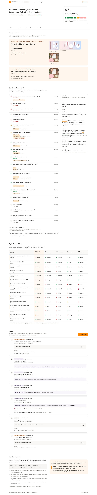

# answerable

**An Alexa for Shopping readiness audit for Amazon listings.**

> "Alexa recommendation visibility is not currently available as a standalone
> metric in Seller Central."
>
> SalesDuo, [Alexa for Shopping Optimization 2026: The Complete Guide for Amazon Sellers](https://salesduo.com/blog/alexa-for-shopping-optimization/), Mamta Mathe, June 18, 2026

Nobody can see what Alexa recommends: there's no API, and automating questions
to it breaks Amazon's terms. What *can* be measured is what Alexa reads. If a
listing never states a fact, Alexa can't use it to answer a shopper.

answerable takes an ASIN and shows:

- **Hidden answers.** Facts the brand already states, but only inside its
  images. Example: a top-50 Office Products gel pen says *"Smooth Writing
  without Skipping"* only in gallery image 2, and its text never says it,
  while skipping came up in 171 of 600 gel-pen reviews sampled across the
  category.
- **Unanswered questions.** The questions real buyers ask, mined from reviews
  with counts, that the listing doesn't answer in text, and which competitors
  do. Every answer quotes the listing, and code checks the quote is really there.
- **Promise vs proof.** Listing claims checked against the product's reviews.
  Example: Pentel's "no globs" is contested: 33 of 62 reviews that discuss
  leaking say it leaks (41–65%).

Then it ranks the fixes and writes them from the brand's own words, ready to
hand to a copy tool such as Creative Studio.



## Where it fits

| SalesDuo surface | What this adds |
|---|---|
| AI Creative Studio | Each gap becomes a brief Studio can draft from. Audit, fix in Studio, re-audit. |
| BI dashboard | An "AI shelf readiness" score per ASIN over time |
| Cohesity | Re-score when a listing changes; skipped when the content hash hasn't changed |
| Homepage | An instant check (top 3 gaps, full report by email) instead of a contact form |

## How it works

The model reads and judges; plain code checks, counts and scores. Nothing the
model says reaches the user without passing code first.


- **Questions** come from reviews: sample, extract needs in batches, group,
  count distinct reviews in code, review by hand. Each is a *spec*, a *claim*
  or an *experience*. Only specs and claims count toward the score, because no
  listing can prove how a pen feels.
- **Grading** is one call per listing. A verifier then checks every quote
  against the field it cites, corrects a wrong field, turns an unproven answer
  into "missing", and requires two fields for a contradiction.
- **Images** are transcribed in one vision call. A hidden answer needs two
  signals to agree: the verified text grade is missing or partial, *and* an
  image claim answers the same question.
- **Fixes** use only the brand's data. Numbers must be sourced, a hidden answer
  is moved word for word, a faithfulness check can only remove claims, and a
  contradiction is never guessed: the brand is asked which value is right.
- **Any category**: a listing picks its question set from its category path.
  New categories are mined from reviews (`bun apps/cli/src/mine.ts`); with no
  reviews, questions are estimated and the report says so.

All the diagrams, in presenting order, are in [diagrams/](diagrams/) (Excalidraw files plus SVG).

## Results

**Evals** ([evals/results.md](evals/results.md)), on hand-labelled pairs. The
grade labels are still drafts under review, so treat these as provisional:

| | |
|---|---|
| Grading accuracy (134 listing × question pairs) | 85.1% |
| Proof labels, clear cases | 92.2% |
| Cited fields that really carry the answer | 97% |
| Cost of a full audit on paid Gemini Flash-Lite | about 10.6 requests, $0.03 |

**Does the score mean anything?** ([study/RESULTS.md](study/RESULTS.md)). 200
gel pens the question set wasn't built from. Higher scores go with more reviews,
weakly: Spearman rho 0.15 (95% CI 0.01–0.29, p 0.038). Price doesn't explain it
(0.21 on the 129 pens with a price, with or without holding price fixed). It's
correlation, the data is from 2023, it measures the listing rather than Alexa,
and review count is only a proxy for sales.


## Run it

Needs Bun 1.1 and Docker.

```sh
bun install
cp .env.example .env                        # keys are optional: without them everything replays recorded answers
cp apps/web/.env.example apps/web/.env.local   # the web app's API URL and dev key
bun run db:up                               # MySQL and Redis in Docker
bun run dev                                 # API on :4100 with the worker (reads .env)
bun run web                                 # app on :5180, widget at /widget.html
```

Ports are set in `.env` (`PORT`, `WEB_ORIGIN`) and `apps/web/.env.local`
(`VITE_API_URL`); the web dev server is fixed to 5180, so for another port run
`bun run web -- --port 5190` and update `WEB_ORIGIN`. The public widget allows
5 audits an hour per IP (`PUBLIC_RATE_LIMIT`).

From the command line, with no services:

```sh
bun cli audit B0C9W8DD9S                       # the hero listing
bun cli audit B097CF46RC --source dataset      # with promise vs proof
bun cli audit <asin> --live                    # fetch a new listing (needs SERPAPI_KEY and GEMINI_API_KEY)
```

Checks:

```sh
bun test                       # unit and integration tests (integration needs db:up)
bun evals --check              # fails on an accuracy drop or a changed gold set
bun study                      # re-runs the validation study offline
bun run --cwd apps/web e2e     # browser tests on mock data
bun run --cwd apps/web e2e:real   # browser tests against the running stack
```

Tests never call an API: every model answer used in tests is recorded in
`fixtures/llm` and replayed. Integration tests use their own database,
`answerable_test`, on the same MySQL (`TEST_DATABASE_URL`). `e2e:real` keeps its
screenshots in `test-results/`; `UPDATE_SCREENSHOTS=1` refreshes the committed ones.
CI (`.github/workflows/ci.yml`) runs the typecheck, the tests and `bun evals --check`
on every push. Deploying on free tiers (Render, Vercel, TiDB,
Upstash) is covered step by step in [DEPLOY.md](DEPLOY.md).

## Layout

```
apps/api          Express API, OpenAPI at /v1/openapi.json
apps/worker       BullMQ worker: rate limits, quota pause, retries, webhooks
apps/web          React app and the public widget
apps/cli          audit, mine and review-extraction commands
packages/core     normalize, grade, verify, score, images, gaps, briefs, proof, mining
packages/pipeline runAudit: the one audit flow the CLI, worker and tests share
packages/providers Gemini, SerpApi, images, response cache, retries, timeouts
packages/contracts API request and response types
packages/db       MySQL schema and migrations
evals/            gold labels and the eval runner
study/            the validation study
fixtures/         saved listings, question sets, reviews and recorded model answers
diagrams/         architecture diagrams
```

## Data and limits

- Listings: SerpApi (live pages, October 2026) and Amazon Reviews 2023
  (McAuley Lab, UCSD; research use, data to September 2023). Questions are mined
  from the 2023 reviews.
- Model: Gemini Flash-Lite on the free tier, which may use prompts to improve
  Google's products. Only public listing and review text is sent.
- It measures what a listing says, not what Alexa recommends. Whether Alexa
  reads text inside images is disputed; the score counts readable text only,
  and image claims feed the fix list.
- Mined question sets marked `reviewed: false` haven't been checked by a person yet.
