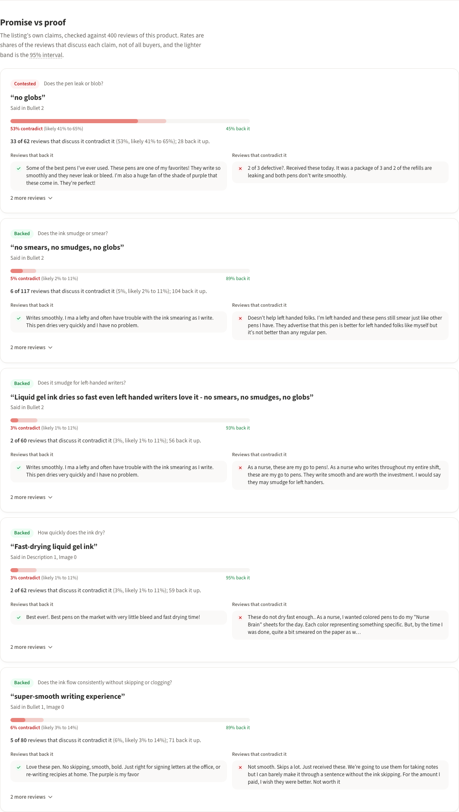
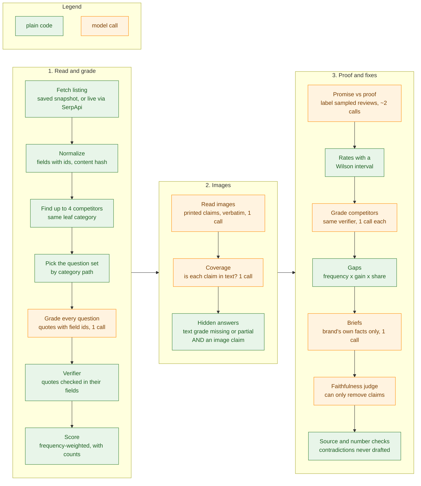
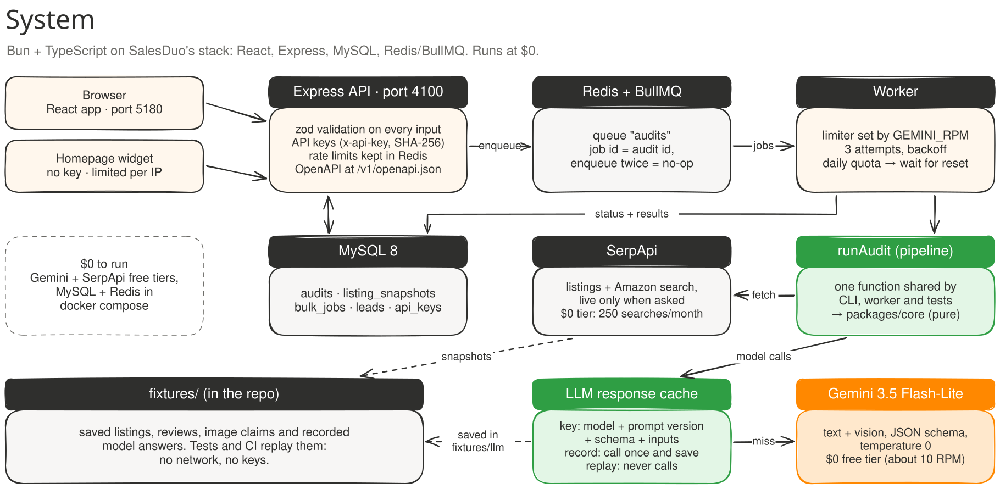
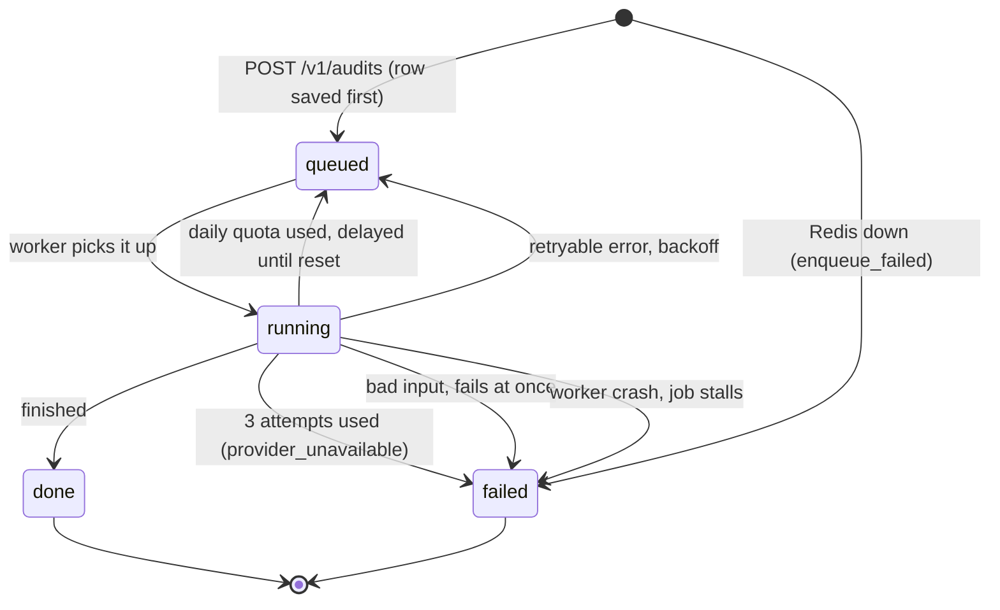
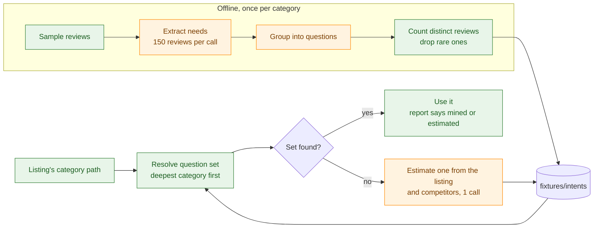

# Aloud

**Make your listing ready to ask.**

An Alexa for Shopping readiness audit for Amazon listings: paste an ASIN and see which shopper
questions the listing answers in text Alexa can read, with proof for every answer and the fixes ranked.

[](https://github.com/rajveeerr/aloud-alexa-audit/actions/workflows/ci.yml)


**Live demo:** coming soon · **Widget:** coming soon · **Video:** coming soon

---

## Why this exists

> "Alexa recommendation visibility is not currently available as a standalone metric in Seller Central."
>
> [Alexa for Shopping Optimization 2026: The Complete Guide for Amazon Sellers](https://salesduo.com/blog/alexa-for-shopping-optimization/), Mamta Mathe, salesduo.com, June 18, 2026

Nobody can see what Alexa recommends: there's no API, and automating questions to it breaks Amazon's terms.
You *can* see what Alexa reads: the title, bullets, description, attributes and reviews.
Aloud measures that. If a listing never states a fact in text, Alexa can't use it to answer a shopper.

## What it finds

Three checks, shown here on the hero listing: a top-50 Office Products gel pen from a small brand,
Ddaowanx (`B0C9W8DD9S`). Its answerability score is **52**: its text **answers 8 of 15** shopper questions
(2 partly, 5 not at all).

- **Hidden answers.** Facts the brand already states, but only inside its images. Ddaowanx says
  *"Smooth Writing without Skipping"* only in gallery and A+ images, while skipping came up in
  **171 of 600** gel-pen reviews sampled across the category, and 4 of 4 competitors answer it (1 partly).
  *"No Smear: Perfect for Left-Handed"* appears only in image 8; the text just says "Ambidextrous".
- **Unanswered questions.** The questions real buyers ask, mined from reviews with counts, that the
  listing doesn't answer in text, and which competitors do. Every answer quotes the listing, and code
  checks the quote is really there.
- **Promise vs proof.** Listing claims checked against the product's own reviews. Pentel's
  *"no globs"* is contested: **33 of 62** reviews that discuss leaking say it leaks (53%, likely 41–65%).

Then it ranks the fixes and drafts them from the brand's own words, ready to hand to a copy tool such
as Creative Studio.

<table>
  <tr>
    <td width="50%"><b>The report</b><br></td>
    <td width="50%"><b>Hidden answers, with the images as proof</b><br></td>
  </tr>
  <tr>
    <td width="50%"><b>Promise vs proof (Pentel, 2023 data)</b><br></td>
    <td width="50%"><b>The homepage widget</b><br></td>
  </tr>
</table>

More screens (the full report, the brief export, bulk audits, integrations, mobile) are in
[apps/web/e2e/screenshots](apps/web/e2e/screenshots/). The browser tests take them against the real stack.

## Where it plugs into SalesDuo

One audit engine behind an API, four places it can surface:

| SalesDuo surface | What Aloud adds | Endpoint |
|---|---|---|
| AI Creative Studio | Each gap becomes a brief in the shape Studio takes. Audit, fix in Studio, re-audit. | `POST /v1/audits/:id/briefs` |
| BI dashboard | An "AI shelf readiness" score per ASIN over time | `GET /v1/asins/:asin/history` |
| Cohesity | Re-score when a listing changes; skipped when the content hash hasn't changed | `POST /v1/rescore` (webhook back) |
| Homepage | An instant check (score and top 3 gaps, full report by email) instead of a contact form | `POST /v1/public/audits` (rate limited) |

The OpenAPI description is served at `/v1/openapi.json`.

## How it works

The model reads and judges; plain code checks, counts and scores. Nothing the model says reaches the
user without passing code first. This is `runAudit`, the one function the CLI, the worker and the tests share:



The system around it, as drawn for the walkthrough:



The full set of hand-drawn diagrams is in [diagrams/](diagrams/) (Excalidraw files plus SVG, with a talk track):

| Diagram | What it explains |
|---|---|
| [01-salesduo-fit](diagrams/01-salesduo-fit.svg) | The four SalesDuo surfaces and the endpoint each one calls |
| [02-system](diagrams/02-system.svg) | Browser and widget, API, MySQL, Redis/BullMQ, worker, Gemini, SerpApi, the response cache |
| [03a-audit-pipeline](diagrams/03a-audit-pipeline.svg) | Steps 1-10, fetch to hidden answers, model steps vs code steps |
| [03b-audit-pipeline](diagrams/03b-audit-pipeline.svg) | Steps 11-15, promise vs proof to faithfulness, and the calls and cost per audit |
| [04a-trust-layer](diagrams/04a-trust-layer.svg) | Each model output for grades and images, and the code check that follows it |
| [04b-trust-layer](diagrams/04b-trust-layer.svg) | The same for briefs, the judge, contradictions and review labels |
| [05-any-category](diagrams/05-any-category.svg) | Where an audit's questions come from, and how sets are mined from reviews |
| [06-job-lifecycle](diagrams/06-job-lifecycle.svg) | The states of an audit row and every way it moves between them |
| [07-evals-and-cost](diagrams/07-evals-and-cost.svg) | The gold set, the eval runner, the CI check and the headline numbers |

## Design decisions

Each one has a number behind it. Click to open.

<details>
<summary><b>The trust layer: nothing the model says reaches the user unchecked</b></summary>

<br>

Every model output is followed by a code check. A grade must quote the listing, and the quote must
appear in the field it cites; a quote found in another field is kept and re-cited, one found nowhere
is dropped, and an "answered" with no surviving quote becomes "missing" and is flagged. A contradiction
needs verified quotes from two different fields. A hidden answer needs two signals to agree: the
verified text grade is missing or partial, *and* an image claim answers the same question, so one wrong
call can't create a finding on its own. In the fixes, every number must come from the brand's data, a
faithfulness check can only remove claims (worst case a draft is lost, never a false claim published),
and a contradiction is never fixed by guessing: when Uni-ball's title says 6 pens and its description
says 3, the brand is asked which is right, with both quotes. The judge caught a real case: the image
says *"Sealed with Wax to Prevent ink from Drying"*, the draft added *"and leaking"*, and it was held back.

What string checks can't catch is a real quote used for the wrong question (the hero's clip bullet,
"book, notebook or bag", was taken as an answer to "what surfaces does it write on?"). That's what the
hand-labelled gold set is for.

</details>

<details>
<summary><b>Spec, claim and experience questions, and why experiences don't count</b></summary>

<br>

A mining spike over 600 gel-pen reviews found 175 raw needs that grouped into 25 questions covering 94%
of mentions, and they came in three kinds. A **spec** is a fact the listing can state (tip size,
refillable). A **claim** is a promise the listing can make and reviews can back or deny (smudge-free,
quick dry). An **experience** only buyers can answer (how smooth it feels, grip comfort); a listing
saying "smooth" settles nothing. So the score counts specs and claims only, and experiences get their
own "only buyers can answer these" section. The reviewed gel-pen set has 23 questions: 19 graded,
4 experience. Narrow questions stay separate: "does it smudge for left-handed writers?" (11 asking)
isn't merged into general smudging, and that is exactly where the hero's second hidden answer sits.

</details>

<details>
<summary><b>One call per listing, everything cached, and a $0 budget</b></summary>

<br>

Free tiers have hard limits: Gemini Flash-Lite around 500 requests a day, SerpApi 250 searches a month.
So all questions for one listing are graded in one structured-output call, the images are read in one
vision call, and mining a whole category's questions took 5 calls. Every model call goes through a cache
keyed by a hash of model, prompt version, schema and inputs (images hashed), so an unchanged listing costs
nothing to re-audit and bumping a prompt version invalidates exactly the calls it should. Recorded
answers live in `fixtures/llm`; replay mode fails on a miss instead of calling the API, so tests and CI
never touch the network. Gemini returns 429 for both per-minute and per-day limits: the client reads the
quota id, retries per-minute limits with backoff, and on the daily cap the queue holds the job until the
reset instead of burning retries or failing it.

<br>



Every path ends in `done` or `failed`, never stuck. A full audit averages 10.6 model requests, about
$0.03 on paid Flash-Lite and $0 on the free tier (see [Results](#results)).

</details>

<details>
<summary><b>Decision models: tested, and not used</b></summary>

<br>

Typed decision models (TypeSafe's Jev and others) and local NLI cross-encoders looked like a fit for the
yes/no review-labelling step, so I measured before adding one. On 40 Pentel reviews about smudging,
hand-labelled (33 support, 4 contradict, 3 mixed), Gemini Flash-Lite in one call got 37/37 clear cases
and 4/4 contradictions with no false alarms. A local DeBERTa-v3 NLI model got **59%** of the clear cases,
2/4 contradictions and 2 false alarms; long, multi-topic reviews defeat a sentence-pair model. Jev turned
out to be paid-only on Vercel's AI Gateway (403 on the free credit; total spent testing: $0.0012), and the
free model was already at 100%, so I didn't pay. The test did change the design: Gemini called all 3
mixed reviews "supports", so there's now a `mixed` label. Labelling sits behind an interface, so a model
that wins on the evals can be swapped in.

</details>

<details>
<summary><b>MySQL, not Postgres or Neon</b></summary>

<br>

SalesDuo's engineering posts list React, Node/Express, MySQL, Redis and Bull, and Creative Studio is a
Vite + shadcn/ui app. Building on the same stack means the API, the queue and the schema could move into
their codebase without a translation step, and the web UI follows Studio's look. So it's MySQL 8.4 with
Drizzle migrations, BullMQ on Redis, Express with zod validation, and React with shadcn/ui. The free
deploy uses TiDB Cloud (MySQL-compatible) and Upstash Redis.

</details>

<details>
<summary><b>Any category: questions are data, not code</b></summary>

<br>

The first version only knew gel pens. Now an audit walks the listing's category path from the deepest
level up and uses the first question set that matches. With none, it estimates a set from the listing
and its competitors in one call, gives every question equal weight, and the report says so. Where reviews
exist, a proper set is mined once per category: mechanical pencils came to 16 questions covering 93% of
needs, dry-erase boards to 15 covering 97%, with completely different questions (ghosting, magnetic,
mounting). Mined sets stay `reviewed: false` until a person checks them; the pencil set misses lead
darkness and hardness, which mining's own report showed it had dropped.

<br>



</details>

<details>
<summary><b>What broke, and how it was fixed</b></summary>

<br>

- **macOS vs Linux file order.** Saved competitors were picked in `readdir` order. APFS gives a fixed
  order and the recordings were made with it; Linux gives another, so inside the Docker image 10 of the
  20 saved dataset listings picked different competitors, built prompts that were never recorded, and
  failed in replay. The fix was sorting by ASIN and re-recording; all 25 saved listings now replay with
  their recorded scores on any OS.
- **A missing fetch timeout.** One Gemini request never answered and a run sat for 50 minutes. In a queue
  worker that stalls everything. Every network call now has a deadline and a timeout is retried.
  `AbortSignal.timeout` didn't fire in Bun 1.1, so it's a plain timer with an `AbortController`, and a
  test fakes a request that never answers.
- **A judge that let praise through.** The faithfulness judge rejected "reliable performance" on one run
  and let "reliable and effortless writing experience" through on the next. So for the main fix type, an
  answer hidden in an image, the draft is now the brand's exact image words, chosen in code. The judge only
  guards the drafts where code can't decide.
- **Recitation refusals.** Gemini returned `finishReason: RECITATION` on a batch of BIC's images. The
  transcriber now splits a refused batch in halves down to single images, so only the one image it really
  won't read is skipped, and the report lists it instead of dropping it silently.

</details>

<details>
<summary><b>Honest limits</b></summary>

<br>

- It measures what a listing says, not what Alexa recommends. Whether Alexa reads text inside images is
  disputed; the score counts readable text only, and image claims feed the fix list.
- The gold labels are drafts under review, so the eval numbers are provisional.
- The validation study is a weak correlation on 2023 data, with review count as a proxy for sales.
- Borderline links between an image claim and a question vary between runs; an earlier recording of the
  hero had a third hidden answer that a later one didn't link.
- Live listings come without review text, so promise vs proof runs on dataset listings or when reviews
  are supplied.
- Mined question sets marked `reviewed: false` haven't been checked by a person yet.

</details>

## Results

**Evals** ([evals/results.md](evals/results.md)), replayed offline from recorded answers. The labels are
still being reviewed (all 134 grade labels and 20 of the 60 proof labels are drafts), so treat these
numbers as provisional:

| | |
|---|---|
| Grading accuracy, after the verifier (134 listing × question pairs) | 85.1% |
| Promise vs proof labels, clear cases (60 claim × review pairs) | 92.2% |
| Cited fields that really carry the answer | 97.2% |
| Cost of a full audit on paid Gemini Flash-Lite | about 10.6 requests, $0.0308 |
| Cost on the free tier | $0 |

CI fails if accuracy drops more than two points, or if the gold set or a prompt version changed.

**Does the score mean anything?** ([study/RESULTS.md](study/RESULTS.md))


On 200 gel pens the question set wasn't built from, listings that answer more shopper questions tend to
have more reviews, but weakly: Spearman rho 0.15 (95% CI 0.01–0.29, p 0.038). Price doesn't explain it
(0.21 on the 129 pens with a price, holding price fixed), and the 2023 sales rank points the same way
(rho 0.21, n 174). A correlation this size accounts for about 2% of the variation, so the score can't
predict how any single listing sells, and the effect sits mostly in the top review band (rho 0.41 there,
near zero in the other three). It's correlation, not cause, the data is from 2023, it measures the
listing rather than Alexa, and review count is only a proxy for sales.

## Run it

Needs Bun 1.1 and Docker.

```sh
bun install
cp .env.example .env                        # keys are optional: without them everything replays recorded answers
cp apps/web/.env.example apps/web/.env.local   # the web app's API URL and dev key
bun run db:up                               # MySQL and Redis in Docker
bun run dev                                 # API on :4100 with the worker (reads .env)
bun run web                                 # app on :5180, widget at /widget.html
```

Ports are set in `.env` (`PORT`, `WEB_ORIGIN`) and `apps/web/.env.local`
(`VITE_API_URL`); the web dev server is fixed to 5180, so for another port run
`bun run web -- --port 5190` and update `WEB_ORIGIN`. The public widget allows
5 audits an hour per IP (`PUBLIC_RATE_LIMIT`).

From the command line, with no services:

```sh
bun cli audit B0C9W8DD9S                       # the hero listing
bun cli audit B097CF46RC --source dataset      # with promise vs proof
bun cli audit <asin> --live                    # fetch a new listing (needs SERPAPI_KEY and GEMINI_API_KEY)
```

Checks:

```sh
bun test                       # unit and integration tests (integration needs db:up)
bun evals --check              # fails on an accuracy drop or a changed gold set
bun study                      # re-runs the validation study offline
bun run --cwd apps/web e2e     # browser tests on mock data
bun run --cwd apps/web e2e:real   # browser tests against the running stack
```

Tests never call an API: every model answer used in tests is recorded in
`fixtures/llm` and replayed. Integration tests use their own database,
`aloud_test`, on the same MySQL (`TEST_DATABASE_URL`). `e2e:real` keeps its
screenshots in `test-results/`; `UPDATE_SCREENSHOTS=1` refreshes the committed ones.
CI (`.github/workflows/ci.yml`) runs the typecheck, the tests and `bun evals --check`
on every push. Deploying on free tiers (Render, Vercel, TiDB,
Upstash) is covered step by step in [DEPLOY.md](DEPLOY.md).

## Layout

```
apps/api          Express API, OpenAPI at /v1/openapi.json
apps/worker       BullMQ worker: rate limits, quota pause, retries, webhooks
apps/web          React app and the public widget
apps/cli          audit, mine and review-extraction commands
packages/core     normalize, grade, verify, score, images, gaps, briefs, proof, mining
packages/pipeline runAudit: the one audit flow the CLI, worker and tests share
packages/providers Gemini, SerpApi, images, response cache, retries, timeouts
packages/contracts API request and response types
packages/db       MySQL schema and migrations
evals/            gold labels and the eval runner
study/            the validation study
fixtures/         saved listings, question sets, reviews and recorded model answers
diagrams/         architecture diagrams
```

## Data and limits

- Listings: SerpApi (live pages, October 2026) and Amazon Reviews 2023
  (McAuley Lab, UCSD; research use, data to September 2023). Questions are mined
  from the 2023 reviews. The saved listings are described in [fixtures/README.md](fixtures/README.md).
- Model: Gemini Flash-Lite on the free tier, which may use prompts to improve
  Google's products. Only public listing and review text is sent.
- It measures what a listing says, not what Alexa recommends. Whether Alexa
  reads text inside images is disputed; the score counts readable text only,
  and image claims feed the fix list.
- Mined question sets marked `reviewed: false` haven't been checked by a person yet.
