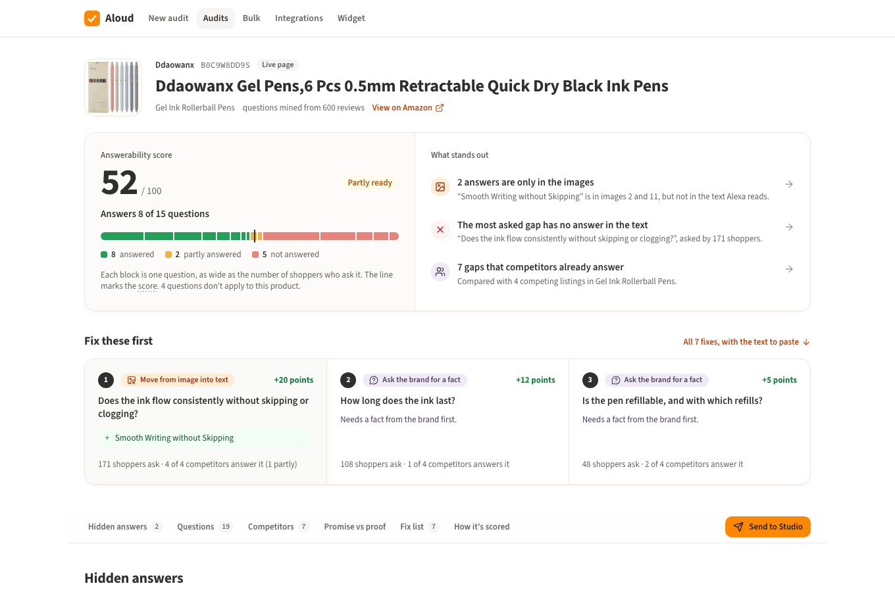
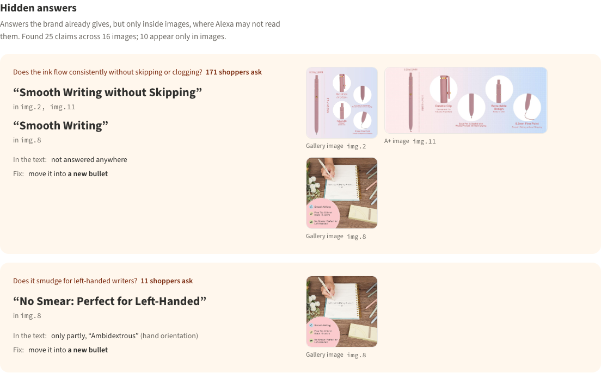
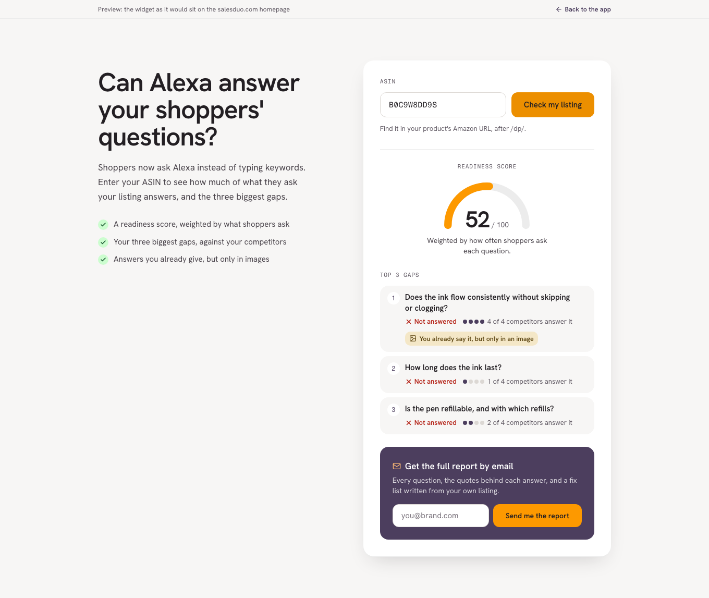
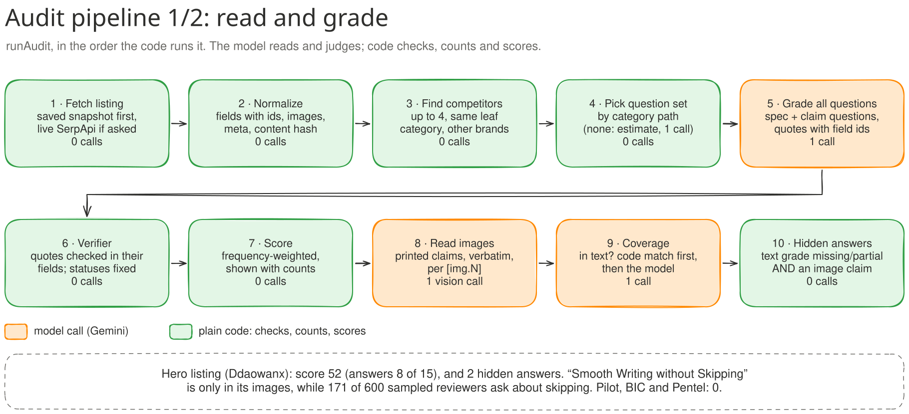
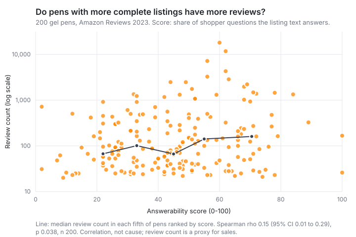

# Aloud

**An Alexa for Shopping readiness audit for Amazon listings.** Make your listing ready to ask.

[](https://github.com/rajveeerr/aloud-alexa-audit/actions/workflows/ci.yml)       

**[Live demo](https://aloud.rajveers.com)** · **[Widget](https://aloud.rajveers.com/widget.html)** · **[API spec](https://aloud-api.onrender.com/v1/openapi.json)** · **[Architecture diagrams](diagrams/)** · **Video:** coming soon

Shoppers ask Alexa questions about products, and Alexa answers from what the listing says. A
brand has no way to see which of those questions its listing leaves unanswered.

> "Alexa recommendation visibility is not currently available as a standalone
> metric in Seller Central."
>
> SalesDuo, [Alexa for Shopping Optimization 2026: The Complete Guide for Amazon Sellers](https://salesduo.com/blog/alexa-for-shopping-optimization/), Mamta Mathe, June 18, 2026

There's no API for Alexa's recommendations, and automating questions to it breaks Amazon's
terms. What can be measured is what Alexa reads. If a listing never states a fact, Alexa can't
use it to answer a shopper.

Aloud takes an ASIN and reports three things:

- **Hidden answers.** Facts the brand states only inside its images. A top-50 Office Products
  gel pen says *"Smooth Writing without Skipping"* in gallery image 2 and nowhere in its text.
  Skipping came up in 171 of 600 gel-pen reviews sampled across the category.
- **Unanswered questions.** Questions mined from real reviews, with counts, that the listing
  doesn't answer in text, and which competitors do answer. Every answer quotes the listing, and
  code checks the quote is really there.
- **Promise vs proof.** Listing claims checked against the product's own reviews. Pentel's "no
  globs" is contested: 33 of 62 reviews that discuss leaking say it leaks (41–65%).

Then it ranks the fixes and drafts them from the brand's own words, ready for a copy tool such
as Creative Studio.

### What the report says about the hero listing

`bun cli audit B0C9W8DD9S` runs it offline from recorded answers:

- **Score 52.** The Ddaowanx 6-pack answers 8 of 15 questions and 2 more partly.
- **Top gap.** Ink flow and skipping: asked in 171 reviews, answered by all 4 competitors,
  missing from the listing text. The images already say "Smooth Writing without Skipping"
  (gallery image 2 and an A+ image).
- **Fixes.** The top one moves that line into a new bullet, word for word. Fifth on the list, a
  draft that added "and leaking" to the wax-seal claim was held back, and the brand is asked for
  the fact instead.



| Hidden answers | Public widget |
|---|---|
|  |  |

## Where it fits

| SalesDuo surface | What this adds |
|---|---|
| AI Creative Studio | Each gap becomes a brief Studio can draft from. Audit, fix in Studio, re-audit. |
| BI dashboard | An "AI shelf readiness" score per ASIN over time |
| Cohesity | Re-score when a listing changes; skipped when the content hash hasn't changed |
| Homepage | An instant check (top 3 gaps, full report by email) instead of a contact form |

Finished audits can also be pushed out as signed webhooks (`audit.completed`, `audit.failed`),
so other systems don't have to poll.

## How it works

The model reads and judges. Plain code checks, counts and scores, and every model output passes
a code check before the user sees it.



- **Questions** come from reviews: sample, extract needs in batches, group, count distinct
  reviews in code, review by hand. Each is a *spec*, a *claim* or an *experience*. Only specs
  and claims count toward the score, because no listing can prove how a pen feels.
- **Grading** is one call per listing. A verifier then checks every quote against the field it
  cites, corrects a wrong field, turns an unproven answer into "missing", and requires two
  fields for a contradiction. A model will happily cite text that isn't there, so nothing counts
  as answered without a quote code can find.
- **Images** are transcribed in one vision call. A hidden answer needs two signals to agree: the
  verified text grade is missing or partial, *and* an image claim answers the same question. One
  misread image or one wrong grade alone can't produce a hidden answer.
- **Fixes** use only the brand's data. Numbers must be sourced, a hidden answer is moved word
  for word, a faithfulness check can only remove claims, and a contradiction is never guessed:
  the brand is asked which value is right. A made-up spec in a listing is worse than a gap,
  because Alexa would repeat it.
- **Any category.** A listing picks its question set from its category path. New categories are
  mined from reviews (`bun apps/cli/src/mine.ts`); with no reviews, questions are estimated and
  the report says so. Question sets are JSON files, so a new category needs no code change.

All the diagrams are in [diagrams/](diagrams/) (Excalidraw files plus SVG).

<details>
<summary><b>Design decisions and trade-offs</b></summary>

- **One model call per listing.** All questions are graded together. On free Gemini (about 500
  requests a day) a 50-listing bulk job costs 50 requests, not 950.
- **Built for $0.** Every model answer is cached by model, prompt version, schema and inputs,
  and tests and CI replay recordings. When the daily quota runs out, the queue pauses until the
  reset. A full audit is about 10.6 requests, $0.03 on paid Flash-Lite.
- **Code decides where a model can't be trusted.** On one run the faithfulness judge let
  "reliable and effortless" slip into a fix. Since then a hidden answer is moved word for word,
  chosen in code, and the judge only guards the rest.
- **Decision models considered.** A local NLI model scored 59% against 100% for Gemini on
  hand-labelled reviews, and Jev is paid-only on the gateway, so neither is used. Labelling sits
  behind an interface so either can be swapped in.
- **MySQL, Redis and Bull** because that's SalesDuo's own stack. TiDB Serverless is the
  MySQL-compatible free host for the demo.
- **Bugs that taught something.** A missing fetch timeout froze a run for 50 minutes. Saved
  audits failed on Linux because file order differs from macOS. Gemini refuses some image
  transcriptions as recitation, so batches split down to single images and refusals are
  reported.

</details>

## Results

**Evals** ([evals/results.md](evals/results.md)). The grade labels were drafted and
independently re-checked, but not yet reviewed by a person, so these numbers are provisional:

| | |
|---|---|
| Grading accuracy (134 listing × question pairs) | 85.1% |
| Proof labels, clear cases | 92.0% |
| Cited fields that really carry the answer | 96% |
| Cost of a full audit on paid Gemini Flash-Lite | about 10.6 requests, $0.03 |

**Does the score mean anything?** ([study/RESULTS.md](study/RESULTS.md)). 200 gel pens the
question set wasn't built from. Higher scores go with more reviews, weakly: Spearman rho 0.15
(95% CI 0.01–0.29, p 0.038). Price doesn't explain it (0.21 on the 129 pens with a price, with
or without holding price fixed). It's a correlation on 2023 data. It measures the listing rather
than Alexa, and review count is only a proxy for sales.



## Run it

Needs Bun 1.1 and Docker.

```sh
bun install
cp .env.example .env                           # keys are optional: without them everything replays recorded answers
cp apps/web/.env.example apps/web/.env.local   # the web app's API URL and dev key
bun run db:up                                  # MySQL and Redis in Docker
bun run dev                                    # API on :4100 with the worker
bun run web                                    # app on :5180, widget at /widget.html
```

From the command line, with no services:

```sh
bun cli audit B0C9W8DD9S                       # the hero listing
bun cli audit B097CF46RC --source dataset      # with promise vs proof
bun cli audit <asin> --live                    # fetch a new listing (needs SERPAPI_KEY and GEMINI_API_KEY)
```

Checks:

```sh
bun test                          # unit and integration tests (integration needs db:up)
bun evals --check                 # fails on an accuracy drop or a changed gold set
bun study                         # re-runs the validation study offline
bun run --cwd apps/web e2e        # browser tests on mock data
bun run --cwd apps/web e2e:real   # browser tests against the running stack
```

Tests never call an API: every model answer used in tests is recorded in `fixtures/llm` and
replayed. CI runs the typecheck, the tests and `bun evals --check` on every push. Integration
tests use their own database, `aloud_test`. If ports 4100 or 5180 are busy, set `PORT` and
`WEB_ORIGIN` in `.env`, `VITE_API_URL` in `apps/web/.env.local`, and run
`bun run web -- --port <n>`.

Deploying on free tiers (Render, Vercel, TiDB, Upstash) is in [DEPLOY.md](DEPLOY.md). How the
evals work and where the labels come from is in [evals/README.md](evals/README.md).

## Layout

```
apps/api           Express API, OpenAPI at /v1/openapi.json
apps/worker        BullMQ worker: rate limits, quota pause, retries, webhooks
apps/web           React app and the public widget
apps/cli           audit, mine and review-extraction commands
packages/core      normalize, grade, verify, score, images, gaps, briefs, proof, mining
packages/pipeline  runAudit: the one audit flow the CLI, worker and tests share
packages/providers Gemini, SerpApi, images, response cache, retries, timeouts
packages/contracts API request and response types
packages/db        MySQL schema and migrations
evals/             gold labels, the eval runner and a local review page
study/             the validation study
fixtures/          saved listings, question sets, reviews and recorded model answers
diagrams/          architecture diagrams
```

## Data and limits

- Listings: SerpApi (live pages, October 2026) and Amazon Reviews 2023 (McAuley Lab, UCSD;
  research use, data to September 2023). Questions are mined from the 2023 reviews.
- Model: Gemini Flash-Lite on the free tier, which may use prompts to improve Google's products.
  Only public listing and review text is sent.
- It measures what a listing says, not what Alexa recommends. Whether Alexa reads text inside
  images is disputed. The score counts readable text only, and image claims feed the fix list.
- Mined question sets marked `reviewed: false` haven't been checked by a person yet.

## What I'd do next

- **Review the gold labels by hand.** All 134 grade labels and 20 of the 60 proof labels are
  re-checked drafts. `bun evals:review` is built for this, and the eval numbers stay provisional
  until it's done.
- **Validate against live sales rank.** The study uses 2023 review counts as a proxy for sales.
  About 50 current listings checked against today's Best Sellers Rank would be a better test.
- **Reviews for live listings.** Live SerpApi listings come without review text, so promise vs
  proof only runs on the 2023 dataset listings.
- **More categories.** There are four question sets. Water bottles are estimated because no
  reviews were mined for them.
- **The reverse direction of promise vs proof**: strengths buyers praise that the listing never
  claims. It needs a pass over all reviews per product instead of one per claim, so it costs
  more calls than the rest of the check.
