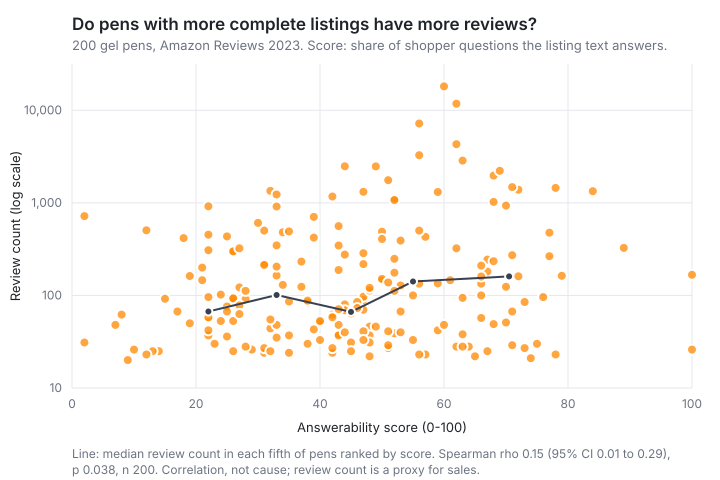

# Validation study: does answerability track demand?

All 200 sampled products were graded.

Across 200 gel pens, listings that answer more of the shoppers' questions tend to have higher review counts. The rank correlation is weak: rho 0.15 (95% CI 0.01 to 0.29), p 0.038, n 200. Holding price fixed changes little. On the 129 pens with a price, the partial correlation is 0.21 (CI 0.03 to 0.38, p 0.017). A correlation this size accounts for about 2% of the variation in rank, and the interval's lower end is 0.01, so the score can't predict how well any single listing sells. The pattern is uneven. Within band 4 (308+ reviews) rho is 0.41 (p 0.003), while inside the other three bands it's near zero, and the average score does not rise steadily from the lowest band to the highest (44.3, 38.4, 49.3, 48.1). The 2023 sales rank stored in the same records points the same way (rho 0.21, CI 0.06 to 0.35, n 174). A correlation doesn't show cause. A brand that writes complete listings may also advertise more, have better distribution or simply be older, and popular products may get better listings because they sell. The listings and counts come from the Amazon Reviews 2023 snapshot. The score measures the listing's readable text (title, bullets, description, attributes) and ignores images and A+ content. It doesn't measure what Alexa for Shopping says. Review count is only a proxy for sales, and it also grows with time on the market.

## Setup

- 200 gel pens from Amazon Reviews 2023 (Gel Ink Rollerball Pens), drawn from 3,632 with at least 3 bullets and at least 20 ratings.
- The 60 products whose reviews were mined for the question set are left out, so no product is graded against questions taken from its own reviews.
- 50 per demand band (quartiles of log10 review count), picked in seeded hash order (`study/select.ts`).
- Each listing's text graded once against the reviewed gel-pen question set (2026-10-27.1) with gemini-3.5-flash-lite, one request per product, no images and no briefs. Recordings are in `study/llm-cache/`, so `bun study` replays everything offline.
- Score: the product's answerability score, 0-100, over spec and claim questions.
- Spearman correlation; 95% CI from 2,000 bootstrap resamples; p from 10,000 permutations. Both seeded.

## Numbers

| test | result |
|---|---|
| score vs log review count, all graded | rho 0.15 (95% CI 0.01 to 0.29), p 0.038, n 200 |
| same, price held fixed (partial Spearman) | rho 0.21 (95% CI 0.03 to 0.38), p 0.017, n 129 |
| same products, price not held fixed | rho 0.21 (95% CI 0.03 to 0.38), p 0.018, n 129 |
| score vs price | rho -0.02 (95% CI -0.21 to 0.16), p 0.815, n 129 |
| score vs 2023 Office Products sales rank (sign flipped, so positive = sells better) | rho 0.21 (95% CI 0.06 to 0.35), p 0.005, n 174 |

The sales-rank row uses the Best Sellers Rank stored in the dataset records (174 of the graded products have one). It's a single 2023 snapshot, so it's a second proxy for sales.

## By demand band

| band | reviews | n | mean score | median | answered | rho within band |
|---|---|---:|---:|---:|---|---|
| 1 | 20-40 | 50 | 44.3 | 44.5 | 5.5 of 15.3 | -0.01 (-0.28 to 0.27), p 0.955 |
| 2 | 41-92 | 50 | 38.4 | 39.5 | 4.6 of 15.1 | -0.13 (-0.39 to 0.17), p 0.367 |
| 3 | 93-302 | 50 | 49.3 | 50 | 6.1 of 15.2 | 0.03 (-0.25 to 0.31), p 0.848 |
| 4 | 308-18,119 | 50 | 48.1 | 50 | 5.9 of 15.3 | 0.41 (0.15 to 0.61), p 0.003 |

## Which questions go unanswered

Share of listings where the question is missing or contradicted, in the lowest band (1) and the highest (4), among listings where it applies (count in brackets).

| question | kind | band 1 | band 4 |
|---|---|---:|---:|
| Does the pen leak or blob? | claim | 88% (50) | 94% (50) |
| Does it smudge for left-handed writers? | claim | 96% (50) | 88% (50) |
| How long does the ink last? | claim | 80% (50) | 84% (50) |
| Does the ink bleed through paper? | claim | 84% (50) | 84% (50) |
| Is the ink waterproof, fade-resistant or archival? | claim | 78% (50) | 74% (50) |
| What paper or surfaces does it write on? | claim | 70% (50) | 68% (50) |
| Is the pen refillable, and with which refills? | spec | 68% (50) | 64% (50) |
| How quickly does the ink dry? | claim | 72% (50) | 62% (50) |
| Does the ink smudge or smear? | claim | 72% (50) | 62% (50) |
| How durable is the pen body and tip? | claim | 72% (50) | 60% (50) |
| Does the ink flow consistently without skipping or clogging? | claim | 34% (50) | 26% (50) |
| How many pens and which ink colors are in the pack? | spec | 12% (50) | 18% (50) |
| What is the tip size or line width? | spec | 10% (50) | 10% (50) |
| Is it retractable (click) or capped? | spec | 10% (50) | 10% (50) |
| How heavy is the pen and how is it balanced? | spec | 8% (50) | 6% (50) |
| Is the ink erasable? | spec | 0% (4) | 0% (9) |
| Does the ink show up on dark or colored paper? | claim | 0% (3) | 0% (3) |
| How much glitter or shimmer is in the ink? | spec | 0% (7) | 0% (2) |
| Is the pen scented, and what does it smell like? | spec | 0% (1) | n/a (0) |

## Future work

- Live sales-rank sub-sample: about 50 current listings through SerpApi, checked against today's Best Sellers Rank instead of 2023 review counts. Not done here.
- Repeat in a second category to see whether the pattern holds outside gel pens.
